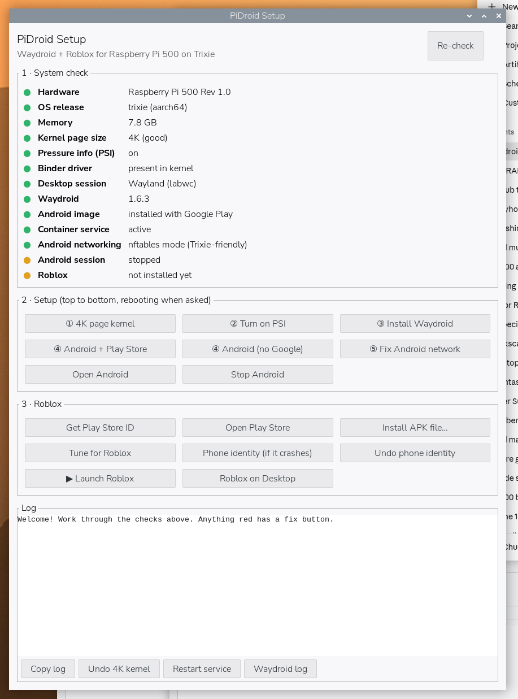

# PiDroid Setup

A point-and-click setup tool for running **Waydroid** (Android) and **Roblox** on a
**Raspberry Pi 500 / Pi 5** with **Raspberry Pi OS Trixie** (labwc Wayland desktop).

 



## Install

```bash
unzip PiDroid-Setup.zip      # or: git clone https://github.com/hardwaremack-prog/pidroid-setup
cd pidroid-setup
bash install.sh              # or double-click install.sh and choose Execute
```

PiDroid Setup then appears on the desktop and in the menu.

## What it does

**1 · System check** — green / yellow / red lights, with a fix button on anything red:

| Check | Why it matters |
|---|---|
| Kernel page size | Pi 5/500 ships a 16K-page kernel; Android needs 4K (`kernel=kernel8.img`) |
| Pressure info (PSI) | Android's memory manager needs `psi=1` |
| Binder driver | The kernel driver Android is built on |
| Desktop session | Waydroid needs Wayland (labwc); one click switches LightDM to it |
| Waydroid / Android image / service | Installs Waydroid, downloads Android (with or without Google Play) |
| Android networking | Switches Waydroid to nftables — fixes "no internet" on Trixie |

**2 · Setup** — numbered buttons, done top to bottom, rebooting when the yellow banner asks.

**3 · Roblox**
- **Get Play Store ID** – prints your Android ID and opens Google's registration page
- **Open Play Store** / **Install APK file…** (`.apk`, `.apkm`, `.xapk`, `.apks`)
- **Tune for Roblox** – mouse acts as touch inside Roblox, Android stays awake
- **Phone identity** – reports Android as a Pixel 5 if Roblox crashes on launch (with Undo)
- **Launch Roblox** / **Roblox on Desktop**

**4 · Screen size**
- **Android window** – Auto, 1280×720, 1600×900, 1920×1080 or 2560×1440, then **Apply to Android**
  (smaller sizes run Roblox smoother on the Pi)
- **Lock Pi screen 1920×1080** / **Unlock Pi screen** – sets the Pi's own display size at boot

On X11, **Open Android** runs Android inside a Weston window as a fallback.

Every command and its output appears in the log; **Copy log** puts it on the clipboard.
Boot-file changes are backed up (`*.pidroid.bak`) and have Undo buttons.

## Getting the Play Store working

1. Open Android, then open the Play Store once (don't sign in yet).
2. Click **Get Play Store ID**, paste the number into Google's page, click Register.
3. Wait 10–15 minutes, Stop then Open Android, and sign in.

## Notes

- Roblox's anti-cheat may refuse to run under Waydroid; the Phone identity button helps
  in many cases but isn't guaranteed. The Pi's GPU suits lighter games best.
- Root steps use `sudo`, falling back to a `pkexec` password box.

## Files

- `pidroid.py` – the GTK 3 app (Python 3, no extra packages on Pi OS)
- `install.sh` – adds the menu and desktop launchers
